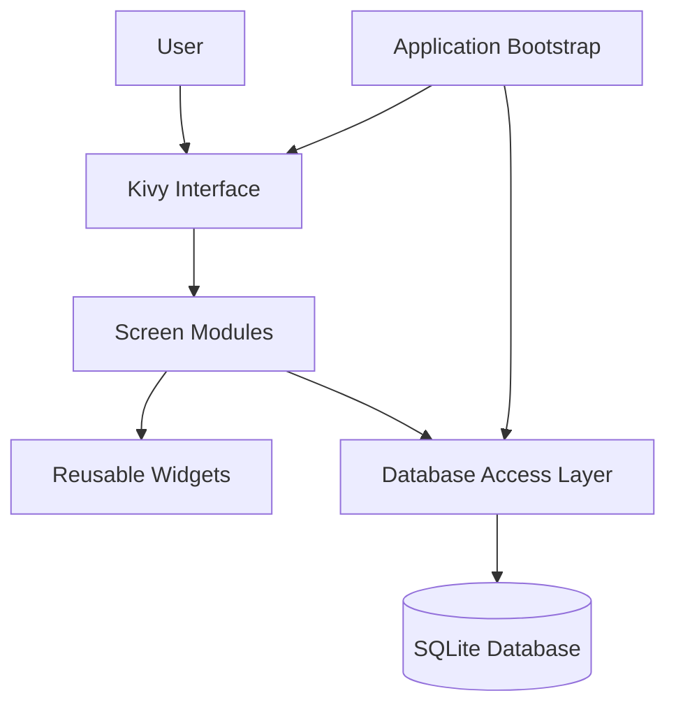

# Architecture

NEXORA is organized as a small layered application. The goal is to keep interface code readable while ensuring persistence rules are reusable and testable.

## System map

## Main components

| Component | Responsibility |
| --- | --- |
| `main.py` | Starts the application. |
| `nexora/app.py` | Builds the root layout, navigation, and screen manager. |
| `nexora/database.py` | Owns SQLite schema and data operations. |
| `nexora/theme.py` | Defines shared colors and visual tokens. |
| `nexora/screens/` | Implements individual application workflows. |
| `nexora/widgets/` | Contains reusable UI helpers. |
| `tests/` | Verifies core persistence behavior. |

## Data flow

1. The application chooses a writable user-data directory.
2. The database layer initializes its schema if it does not exist.
3. A screen calls a database method in response to a user action.
4. The database layer executes parameterized SQL and returns plain Python data.
5. The screen refreshes its visible state.

## Persistence model

- **tasks**: title, details, completion state, creation timestamp.
- **notes**: title, body, creation timestamp.
- **focus_sessions**: completed duration and completion timestamp.

SQLite connections are short-lived and scoped to individual operations. SQL values are parameterized rather than interpolated into query strings.

## Extension guidelines

- Keep SQL and schema changes inside the database layer.
- Keep screen-specific presentation inside its screen module.
- Put shared presentation helpers in `nexora/widgets/`.
- Add tests for new persistence behavior.
- Document migrations before introducing incompatible schema changes.

## Current boundaries

The current foundation does not include user accounts, remote synchronization, a plugin loader, or cross-device conflict resolution. Those require separate design work and are not implied by the current local database.
